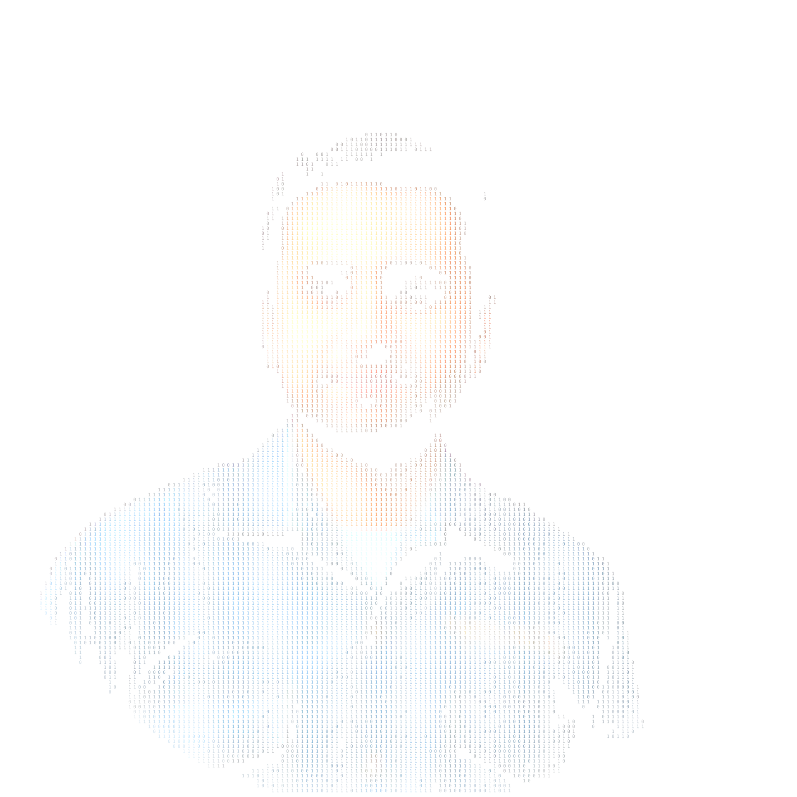

  
  
  <h1>Hi, I'm Aditya Chauhan 👋</h1>
   
     
  
  <h3> Software Engineer | Final-Year CSE Student @ NITJ  </h3> 
  
 Building concurrent systems, distributed backends and performance-critical software. 

  
 Ex-Software Engineering Intern @ Accenture 

  
<b>Open to Full-Time SDE Roles (2027) and Internships (Jan–Jun 2027) </b>
 
  
  
 
     
  
 
  
  
 
    &nbsp;
    &nbsp;
    &nbsp;
     
  
 

 
  

<!-- --- --> 

  

## 
`~/what_i_built`
 

### `/featured_projects` 
<table width="100%"> 
  <tr> 
    <td width="50%" valign="top"> 
      <h2><a href="https://github.com/0xAditya-Labs/SwiftCache" target="_blank">SwiftCache</a></h2> 
      

      
 C++17 concurrent TCP cache server with sharded LRU, TTL eviction and thread-safe client handling. 

      <h4><code>C++</code> <code>TCP/HTTP</code> <code>Concurrency</code></h4> 
      
 
         
      
 
    </td> 
    <td width="50%" valign="top"> 
      <h2><a href="https://github.com/0xAditya-Labs/Interlock/tree/distributed-backend" target="_blank">Interlock</a></h2> 
      

      
 Distributed real-time messaging platform using WebSockets and Redis Pub/Sub, with Redis-backed multi-tab presence. 

      <h4><code>MERN</code> <code>Socket.io</code> <code>Redis</code> <code>JWT</code></h4> 
      
 
         &nbsp;&nbsp; 
         
      
 
    </td> 
  </tr> 
  <tr> 
    <td width="50%" valign="top"> 
      <h2><a href="https://github.com/0xAditya-Labs/ContextIQ" target="_blank">ContextIQ</a></h2> 
      
  

      
 LangGraph ReAct agent with tool gating, optimized ChromaDB retrieval and OpenTelemetry observability. 

      <h4><code>LangGraph</code> <code>ChromaDB</code> <code>OpenTelemetry</code></h4> 
      
 
         &nbsp;&nbsp; 
         
      
 
    </td> 
    <td width="50%" valign="top"> 
      <h2><a href="https://github.com/0xAditya-Labs/ISP-Customer-retention-Recommender" target="_blank">RetainOps</a></h2> 
      

 
      
Targeted top 20% of customers via a custom Master Model Score across 5 tuned classifiers. Improved reliability by engineering 9 features from 7,100+ records, mitigating a 3:1 imbalance with SMOTE and SHAP.
 
      <h4><code>React</code> <code>FastAPI</code> <code>Scikit-learn</code> <code>SHAP</code></h4> 
      
 
         &nbsp;&nbsp; 
         
      
 
    </td> 
  </tr> 
</table> 

<!-- FUTURE:ARTICLES:START --> 
<!-- FUTURE:ARTICLES:END --> 

  

<!-- FUTURE:OPEN_SOURCE:START --> 
<!-- FUTURE:OPEN_SOURCE:END --> 

  

<!-- --- --> 

  

## 
`~/algorithmic_engine`
 

### `/algorithmic_coding_competitions` 
<ul> 
  <li>🏆 <b>Adobe University Hackathon 2026:</b> <i>Shortlisted for Round 2 (Top 1.5%)</i> from 301K+ global applicants.  <a href="https://drive.google.com/file/d/14IOH9KdQtAjKinFuqg9G0FBDU7ex79DB/view" target="_blank">🔗</a></li> 
  <li>🏆 <b>Flipkart GRiD 2025 and 2026:</b> <i>Semi-Finalist in 7.0 and 8.0</i>, placing in the <i>top 0.5%</i> among 3.2 lakh+ participants. <a href="https://drive.google.com/file/d/1fo9QLQ7mtOa8pIQBL6QhXwJf_wiiQlQo/view" target="_blank">🔗</a> </li> 
  <li>🏆 <b>Meta Hacker Cup 2025:</b> Advanced to Round 2, securing <i>Global Rank 3223 (AIR 875)</i> out of thousands of competitors.  <a href="https://drive.google.com/file/d/1y4h0AfrGKVywfINEaF8LWSFVV2ev-pU3/view" target="_blank">🔗</a> </li> 
  <li>🏆 <b>CodeStorm 2024:</b> Secured <i>3rd place</i> in GDSC NIT Jalandhar's competitive programming contest. <a href="https://drive.google.com/file/d/1NspDFZEjo7HGUsO7XCMoB5LwtygitteN/view" target="_blank">🔗</a> </li> 
</ul> 

### `/coding_profiles` 
<!-- STATS:START -->
<ul style="list-style-type: none; padding-left: 0;">
  <li>
    &nbsp;
    <b>LeetCode</b> -- Knight (Max Rating: 1982, Top 2.93%, 800+ Q solved)&nbsp;
    
  </li>
   
  <li>
    &nbsp;
    <b>Codeforces</b> -- Specialist (Max Rating: 1418, 75+ rated contests, ~500 Q solved)&nbsp;
    
  </li>
   
  <li>
    &nbsp;
    <b>CodeChef</b> -- ★★★ (Max Rating: 1661)&nbsp;
    
  </li>
</ul>

<!-- ADD THE GRAPHS/STATS OF CF AND LC WHEN U BECOME EXPERT IN CF AND GAURDIAN IN LC USING JACOB CARDS ==> Check commit : d761400a4b5a9b94e0b4f700e9ad995491ec5289-- >

 

<!-- STATS:END --> 

<!-- FUTURE:HACKATHONS:START --> 
<!-- FUTURE:HACKATHONS:END --> 

  

<!-- --- --> 

  

<!-- FUTURE:STATS_RADAR:START it stats like stars etc etc--> 
<!-- FUTURE:STATS_RADAR:END --> 
<!-- ADD EXPERIENCE --> 
<!-- ADD TECHH STACK/ARSENEL --> 
<!-- ADD ACHIEVEMENTS --> 
<!--  --> 

## 
`~/about_me`
 

  

I build complete systems, not isolated features — I'm equally comfortable optimizing what happens at the OS/memory layer and what a user actually clicks on. My focus stays on the boundary most people skip: what makes a system correct and fast under real concurrent load, not just correct in a demo.
 

<ul> 
  <li>🎓 <b>Education:</b> B.Tech in CSE @ NIT Jalandhar, Final Year</li> 
  <li>💼 <b>Experience:</b> 
    <ul>
  <li>💼 <b>Experience:</b>
    <ul>
      <li>Ex-SDE Intern @ <a href="https://www.accenture.com/in-en">Accenture</a>, Bangalore (May–Aug 2026), GenAI/RAG document intelligence</li>
      <li>CP Team Lead @ <a href="https://gdg.community.dev/gdg-on-campus-dr-b-r-ambedkar-national-institute-of-technology-jalandhar-jalandhar-india/">Google Developer Group, NITJ</a></li>
    </ul>
  </li>
  <li>🧠 <b>Obsessions:</b>
    <ul>
      <li>DSA and CP-grade problem solving</li>
      <li>Systems that stay correct under load, not just in happy-path demos</li>
    </ul>
  </li>
  <li>🎧 <b>Soundtrack:</b> anything that sounds like an epic movie finale (Sia, The Score, Diljit Dosanjh, Karan Aujla)</li>
  <li>🔍 <b>Ask me about:</b> concurrency, OS internals, DBMS recovery (ARIES), RAG chunking, React frontends</li>
</ul>

  

<!-- --- --> 

  

## 
`~/the_human`
 

<!-- I'm a nerd at heart — **maths, physics, and research rabbit holes** get me as excited as code does. When I'm not building something, there's a good chance I'm either **writing stories or drawing Pokémon** — my default creative modes. Outside of tech, I have way too much energy: you'll find me doing **badminton, swimming, dancing, or gymnastics.** People keep handing me responsibility, and I've learned to enjoy **bringing people together, unfurling positivity, and getting things done.** Switching off means the **MCU or an anime universe.** No exceptions. -->

I'm a nerd at heart: **maths, physics, and research rabbit holes** excite me as much as code.

Off the keyboard, I make things: stories, drawing Pokémon, cardboard builds, and VFX videos where I play the superhero. Gymnastics, dancing, and badminton burn off the rest of the energy.

What I love most is talking to ambitious people and building something together, seriously and make real friends along the way. 
If that's you, tell me what you're making that has nothing to do with your day job.

   
  <b>Let's connect</b>
    
  &nbsp;
  &nbsp;
  
    

  

  <i>"The truth is... I am Iron Man."</i>
   
  <i>Jai Parmatma</i> 🪄🦚

